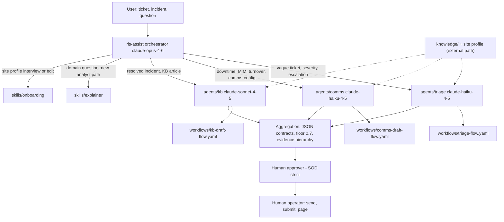

# ris-assist - OpenGAP gitagent

Radiology IT overnight support assistant as an OpenGAP multi-agent
orchestration, in the full template format. Ported from the ris-assist
Claude Code plugin (github.com/b08x/ris-assist): PERSONA-SPEC.md became
SOUL.md, the analyst subagent became three specialist drafter agents,
the five plugin skills split into sub-agent skills (troubleshoot, comms,
knowledge) and orchestrator skills (explainer, onboarding), and the slash
commands became delegation triggers and skillflow triggers.

## Delegation map



## Model routing

| Agent | Model | Why |
|---|---|---|
| ris-assist (orchestrator) | claude-opus-4-6 (fallback sonnet) | classification, aggregation, synthesis, escalation judgment |
| triage | claude-haiku-4-5 (fallback sonnet) | short-turn Q&A, differential bookkeeping |
| comms | claude-haiku-4-5 (fallback sonnet) | slot-filling and register reshaping from fixed templates |
| kb | claude-sonnet-4-5 (fallback opus) | long-form drafting from a worklog - highest invention-risk work |

## Layout

Full template: agent.yaml (complete compliance configuration), SOUL.md,
RULES.md, DUTIES.md, AGENTS.md, PROMPT.md, compliance/ (regulatory map,
risk assessment, validation schedule), config/, hooks/ (session
lifecycle, advisory), knowledge/ (domain reference index), memory/
(MEMORY.md + memory.yaml), skills/ (explainer, onboarding), workflows/
(three deterministic skillflows), agents/ (triage, comms, kb - each a
recursive gitagent with its own full-format agent.yaml, SOUL.md, PROMPT.md,
RULES.md, and skill).

Site and comms profiles are runtime inputs at user-confirmed paths
OUTSIDE this repo - never committed, never searched for.

## Migration (one time)

Reference docs, the renderer script, and examples are copied verbatim
from the source plugin:

```bash
git clone https://github.com/b08x/ris-assist /tmp/ris-assist-plugin
mkdir -p knowledge/docs \
  agents/comms/skills/comms/references \
  agents/kb/skills/knowledge/references \
  agents/kb/skills/knowledge/scripts \
  skills/onboarding/references \
  examples
cp /tmp/ris-assist-plugin/skills/explainer/references/*.md knowledge/docs/
cp /tmp/ris-assist-plugin/skills/comms/references/*.md agents/comms/skills/comms/references/
cp /tmp/ris-assist-plugin/skills/knowledge/references/*.md agents/kb/skills/knowledge/references/
cp /tmp/ris-assist-plugin/skills/knowledge/scripts/html_to_docx.py agents/kb/skills/knowledge/scripts/
cp /tmp/ris-assist-plugin/skills/onboarding/references/site-profile.schema.md skills/onboarding/references/
cp /tmp/ris-assist-plugin/examples/* examples/
git add . && git commit -m "Migrate reference docs and examples from source plugin"
```

## Export

The set is framework-agnostic as delivered. When a target runtime is
needed:

```bash
opengap export -f claude-code   # closest to the original plugin
opengap export -f crewai
opengap export -f langgraph
opengap export -f openai
```

Identity (SOUL.md), duties (DUTIES.md), rules (RULES.md), and skills are
preserved unchanged across exports; only the native encoding differs.

## Non-goals carried from the source plugin

This agent set drafts and recommends. It does not send notifications,
submit KB articles, page anyone, decide severity autonomously, parse HL7
at segment/field level, handle identified PHI, or take any state-changing
action against a production system. DUTIES.md makes those boundaries
structural, not aspirational.
